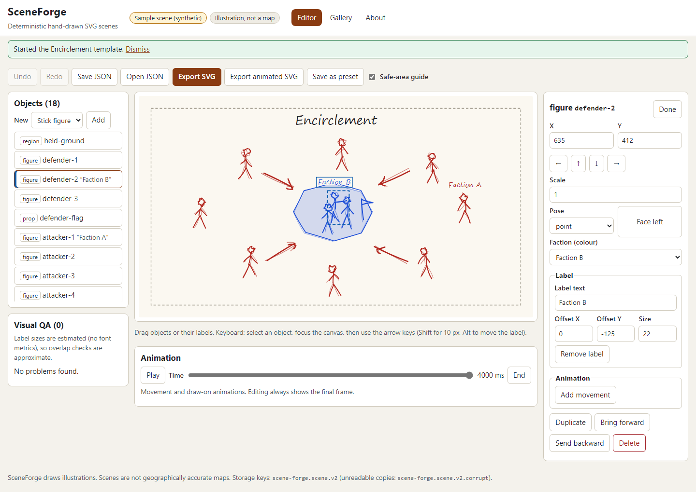

# SceneForge

A procedural SVG studio for hand-drawn looking diagrams: stick figures, arrows, props and regions,
built from eight templates and edited on a canvas. Every stroke comes from a seeded generator, so the
same scene file, style version and seed always produce **exactly the same SVG**.



> **Status:** v0.1, published. **[Try the demo](https://patrickndevelopment.github.io/scene-forge/)** or run it locally (below). Scenes are illustrations; they are not maps and are not
> geographically accurate.

## What it does

- **Eight templates**: encirclement, retreat, siege, trade route, supply line, alliance formation,
  alliance collapse and timeline. Faction names and colours are yours; the defaults are invented.
- **Deterministic hand-drawn style**: double-pass jittered strokes from a seeded PRNG keyed by each
  object's continuity id, so editing one object never changes the strokes of another. Change the
  style seed for a new hand, or regenerate a template layout with a seed while keeping your factions
  and the labels you moved.
- **Editor**: object list, canvas with drag (objects and labels separately), inspector with labelled
  inputs for position, scale, pose, prop, faction colour, label text, offset and size, plus
  keyboard control (arrow keys move, Alt+arrows move the label, Shift for 10 px, Delete, Escape).
- **Animation**: movement and draw-on, previewed with a time slider and Play. Playback is off when
  the system asks for reduced motion; animated SVG exports wrap their keyframes in
  `prefers-reduced-motion: no-preference`.
- **History**: undo and redo (200 steps; a drag or a burst of nudges is one step), by buttons or
  Ctrl+Z / Ctrl+Y.
- **Files**: save and reopen scene JSON (strictly validated; version 1 files are upgraded), export
  static or animated SVG (vector, valid XML, no scripts or external references), save presets in a
  gallery.
- **Visual QA**: off-canvas and partly off-canvas objects, objects outside the safe area, label
  overlap (estimated text size) and colour contrast against the paper.

## Quick start

Needs Node.js 20.19 or newer.

```powershell
npm ci
npm run dev        # http://localhost:5175/scene-forge/
npm run verify     # format, lint, types, unit + golden tests, build, secret scan, e2e
```

`scripts\verify.ps1` and `scripts/verify.sh` run the same steps and stop on the first failure.

## The scene format

A scene is one JSON document (`scene-forge.scene`, version 2): canvas, safe area, factions, objects
with continuity ids, labels, animations and the style seed. See
[docs/spec/00-scene-format.md](docs/spec/00-scene-format.md); rendering rules are in
[docs/spec/01-rendering.md](docs/spec/01-rendering.md).

## Honest limits

No backend, no accounts, no network calls. Label sizes in QA are estimates. Fonts are whatever
hand-writing font the viewer has (Segoe Print, Comic Sans MS or a cursive fallback), so text width
differs between machines; the geometry does not. See
[docs/known-limitations.md](docs/known-limitations.md).

## Documentation

[docs/architecture.md](docs/architecture.md), [docs/demo.md](docs/demo.md),
[docs/test-report.md](docs/test-report.md), [docs/handoff.md](docs/handoff.md),
[docs/backlog.md](docs/backlog.md), [SECURITY.md](SECURITY.md), [CONTRIBUTING.md](CONTRIBUTING.md),
[AI_ASSISTANCE.md](AI_ASSISTANCE.md).

## License

MIT, see [LICENSE](LICENSE). No third-party art is included; every shape is drawn by code.
